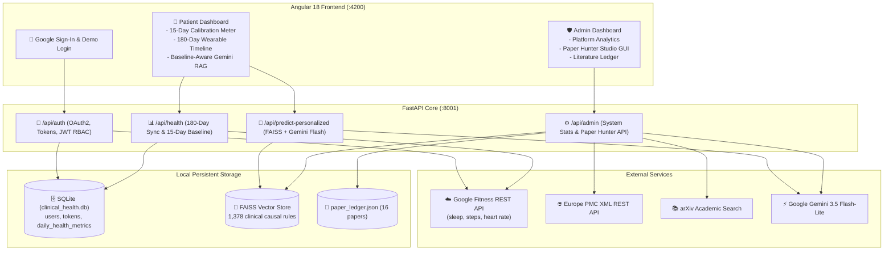
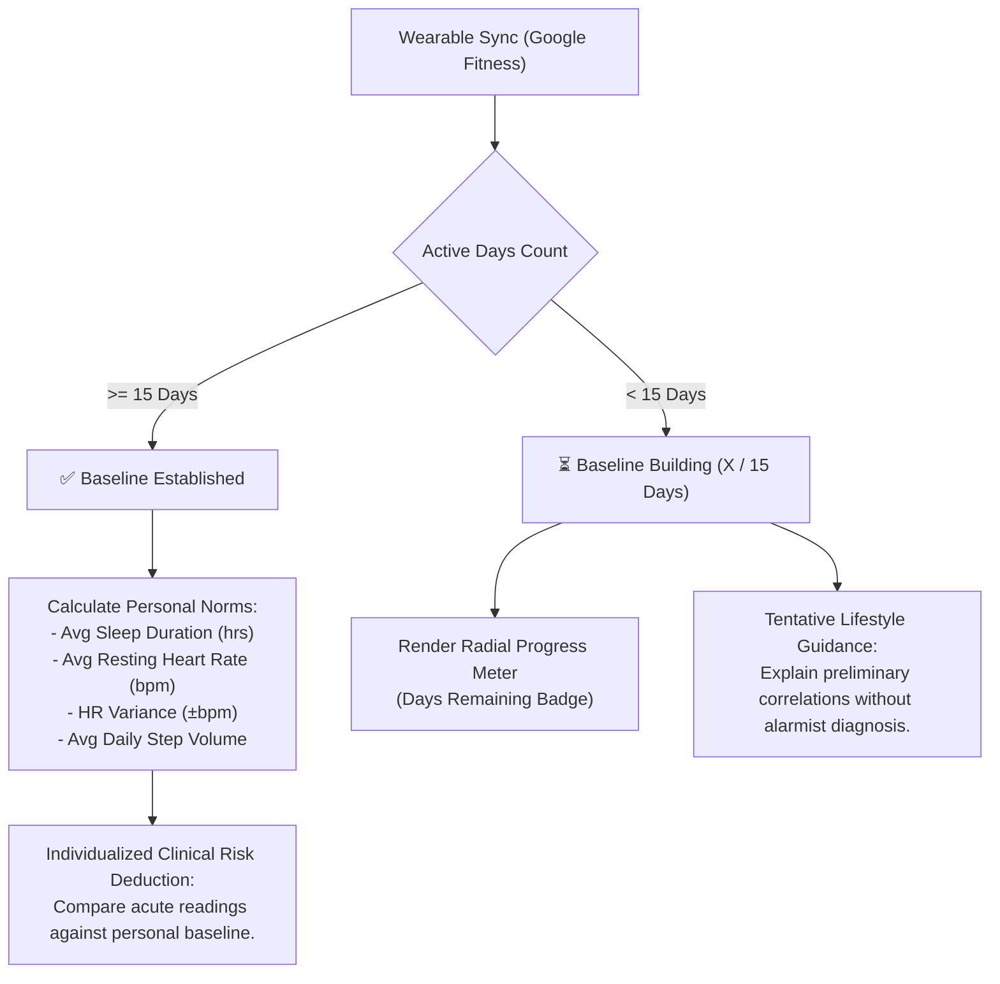
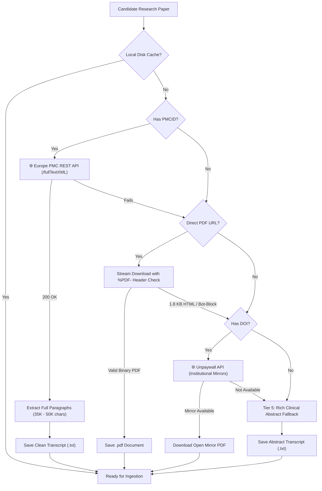

# 🧬 Biomedical Rules Extractor & Clinical Health RAG System

[](https://www.python.org/)
[](https://angular.dev/)
[](https://fastapi.tiangolo.com/)
[](https://developers.google.com/fit)
[](https://ai.google.dev/)
[](https://www.langchain.com/)
[](https://github.com/facebookresearch/faiss)
[](https://sqlite.org/)
[](https://europepmc.org/)
[](https://arxiv.org/)

> **A peer-reviewed Clinical Intelligence & Retrieval-Augmented Generation (RAG) platform. Features Google Health OAuth2 synchronization (180 days history), a 15-day physiological baselining engine, an Angular 18 web dashboard with an in-browser Research Paper Hunter Studio GUI, and Gemini 3.5 Flash clinical risk synthesis grounded in 1,378 embedded causal vectors.**

---

## 📌 Table of Contents
1. [Overview](#-overview)
2. [Key Capabilities & Features](#-key-capabilities--features)
3. [System Architecture](#-system-architecture)
4. [Google Health & Google Fitness OAuth2 Sync](#-google-health--google-fitness-oauth2-sync)
5. [15-Day Physiological Baselining Engine](#-15-day-physiological-baselining-engine)
6. [Angular 18 Frontend Dashboard](#-angular-18-frontend-dashboard)
7. [Research Paper Hunter Studio GUI](#-research-paper-hunter-studio-gui)
8. [Zero-Skip Multi-Source Document Resolver](#-zero-skip-multi-source-document-resolver)
9. [Causal Rule Schema](#-causal-rule-schema)
10. [Vector Storage & Ollama Embeddings](#-vector-storage--ollama-embeddings)
11. [Clinical Synthesis API (Gemini RAG)](#-clinical-synthesis-api-gemini-rag)
12. [One-Click Launcher (`start.cmd`)](#-one-click-launcher-startcmd)
13. [Step-by-Step Setup Guide](#-step-by-step-setup-guide)
14. [Project Structure](#-project-structure)
15. [Troubleshooting & Resilience Engineering](#-troubleshooting--resilience-engineering)

---

## 🔬 Overview

Consumer wearable devices monitor continuous biological metrics: **heart rate, heart rate variability (HRV), sleep staging (Deep, REM, Light), and daily step volume**. However, translating these raw measurements into meaningful preventive guidance requires grounding in peer-reviewed clinical research and understanding an individual's personal physiological baseline.

This project delivers a complete clinical intelligence stack:
1. **Google Health OAuth2 Integration**: Securely links a user's Google account to pull the past 6 months (180 days) of daily steps, sleep stages, and heart rate data.
2. **15-Day Baselining Algorithm**: Calculates personal normal distributions ($\mu \pm 1.5\sigma$). When a baseline is established ($\ge 15$ days), acute sensor anomalies are compared against personal norms. If incomplete ($< 15$ days), the system generates cautious, provisional lifestyle guidance without premature diagnostic alarms.
3. **Angular 18 Dashboard**: Mobile-responsive web application featuring:
   - **Patient Dashboard**: Baseline progress tracker, 180-day biometric history timeline, and interactive clinical evaluation console.
   - **Admin Dashboard**: System analytics (users, datapoints, 1,378 vectors) + **Research Paper Hunter Studio GUI** for hunting and extracting peer-reviewed literature in the browser!
4. **Zero-Skip Document Resolver**: Bypasses publisher paywalls using Europe PMC's `fullTextXML` REST API and institutional open-access mirrors.
5. **High-Speed Gemini Flash-Lite Extraction**: Extracts structured bivariate causal rules in **~3–9 seconds** per paper.

---

## ⚡ Key Capabilities & Features

| Capability | Previous State | Current State | Impact |
| :--- | :--- | :--- | :--- |
| **User Onboarding** | None / Manual CLI prompts | Google OAuth2 Sign-In with automatic profile & token management | **1-Click Secure Onboarding** 🔑 |
| **Wearable Data Sync** | Simulated synthetic numbers | 180-day real sync from Google Fitness REST API | **Real Physiological Grounding** ⌚ |
| **Personalized Baselining** | Generic static thresholds | 15-day rolling statistical calibration ($\mu \pm 1.5\sigma$) | **True Individualized Medicine** 📊 |
| **Frontend Interface** | Terminal only | Full-featured Angular 18 standalone dashboard with Tailwind CSS | **Production-Ready Web App** 💻 |
| **Paper Hunter GUI** | Terminal CLI (`paper_hunter.py`) | In-browser Research Studio with live rule discovery preview | **Interactive Admin GUI** 🔎 |
| **Extraction Speed** | 120–160 seconds per paper | **~3–9 seconds** via `gemini-3.5-flash-lite` | **~25x Acceleration** ⚡ |
| **Development Experience** | Separate manual commands | [`start.cmd`](start.cmd) one-click launcher with live auto-reload on both servers | **Zero Friction** 🚀 |

---

## 🏗️ System Architecture



---

## ⌚ Google Health & Google Fitness OAuth2 Sync

- **Service**: Built in [`google_health_service.py`](google_health_service.py).
- **Google Cloud Console Client ID**: `1059027165335-m2h68ikq9uremd83bk07bvmkprmn3ede.apps.googleusercontent.com`
- **Authorized Scopes**:
  - `.../auth/fitness.activity.read` (step count, active minutes)
  - `.../auth/fitness.sleep.read` (sleep stages, duration, deep & REM sleep)
  - `.../auth/fitness.heart_rate.read` (resting and daytime heart rate)
  - `.../auth/userinfo.profile` & `.../auth/userinfo.email`
- **30-Day Rolling Window Chunking**:
  The Google Fitness `dataset:aggregate` API restricts query durations to a maximum of 30 days. Our synchronizer automatically partitions the 180-day range into **6 sequential 30-day windows**, avoiding the `400: aggregate duration too large` error and storing full 6-month biometric histories into SQLite.

---

## 📈 15-Day Physiological Baselining Engine

Before issuing medical risk analyses, the engine tracks user calibration:



- **Baseline Ready ($\ge 15$ days)**: Evaluates acute physiological anomalies (e.g., 3.5 hrs sleep, 98 bpm HR) relative to the user's specific baseline averages and variance, grounding the risk in local FAISS literature rules.
- **Baseline Building ($< 15$ days)**: Clearly displays the remaining days needed to complete calibration and provides tentative, educational recommendations.

---

## 💻 Angular 18 Frontend Dashboard

Scaffolded as a standalone Angular 18 application with Tailwind CSS in [`frontend/`](frontend/):

### 1. Patient / User Dashboard (`/dashboard`)
- **15-Day Baseline Card**: Displays calibration status, days collected/remaining, and statistical baselines (sleep, resting HR, variance, steps).
- **Wearable Sync Timeline**: Sleek 14-day history table directly populated from Google Fitness with sleep breakdown (deep/REM), resting heart rate, and steps.
- **Interactive Clinical RAG Console**: Sliders and custom note inputs to test acute wearable readings against FAISS rules and receive Gemini clinical risk reports.

### 2. Admin Intelligence Console (`/admin`)
- **Platform Analytics**: Total users, total biometric data points, FAISS causal vectors (1,378), and indexed literature count.
- **Literature Ledger Table**: Complete audit history of all peer-reviewed studies in [`paper_ledger.json`](paper_ledger.json).

---

## 🔎 Research Paper Hunter Studio GUI

Admins no longer need to run the terminal CLI to expand the vector database. The **Research Paper Hunter Studio** is embedded directly into the Admin Web UI:

```text
┌────────────────────────────────────────────────────────────────────────┐
│ 🔎 Research Paper Hunter Studio (Admin GUI)                            │
│ ┌───────────────────────────────────────────────┐ ┌──────────────────┐ │
│ │ circadian rhythm arterial blood pressure      │ │  Search Papers   │ │
│ └───────────────────────────────────────────────┘ └──────────────────┘ │
│                                                                        │
│ Candidate Papers Found (3):                                            │
│ ┌────────────────────────────────────────────────────────────────────┐ │
│ │ [NEW CANDIDATE]  Europe PMC  PMC13109090                           │ │
│ │ Daily step-count and sleep metrics across pregnancy...             │ │
│ │ 👤 Alissa C. Smethers et al. (2024)                                │ │
│ │ 📝 Prospective observational analysis measuring step counts...    │ │
│ │                                           [ Extract Causal Rules ] │ │
│ └────────────────────────────────────────────────────────────────────┘ │
│                                                                        │
│ 🎉 Successfully Ingested (+9 Rules in 9.46s):                          │
│ ➔ daily step count (increases) + sleep latency (decreases)             │
│    leads to faster sleep onset                                         │
│ ➔ Total vectors expanded to: 1,378 vectors                             │
└────────────────────────────────────────────────────────────────────────┘
```

1. Enter any biomedical research idea into the search bar.
2. The UI queries Europe PMC and arXiv APIs and marks whether papers are `[NEW]` or `[IN LOCAL VECTOR STORE]`.
3. Click **"Extract Causal Rules"**:
   - Executes the 5-Tier Document Resolver (Europe PMC REST XML / Direct PDF).
   - Prompts Gemini 3.5 Flash-Lite.
   - Extracts structured bivariate rules in **~3–9 seconds**.
   - Embeds into local FAISS and updates the ledger live!

---

## 🛡️ Zero-Skip Multi-Source Document Resolver

Publishers like Oxford Academic and BMJ block automated PDF scrapers with 1.8 KB HTML bot-blocks. The resolver uses a 5-tier waterfall:



---

## 📋 Causal Rule Schema

Extracted relations conform to a rigorous 7-field biomedical relational format:

```json
{
  "metric_a": "sleep duration",
  "change_a": "decreases",
  "metric_b": "risk of major adverse cardiovascular events",
  "change_b": "increases",
  "predicted_outcome": "major adverse cardiovascular events",
  "confidence_rationale": "Prospective analysis of 71,455 UK Biobank participants demonstrated that device-measured short sleep duration combined with low step counts significantly amplified incident major adverse cardiovascular event (MACE) hazard ratios.",
  "author_name": "Joreintje D. Mackenbach et al.",
  "publication_date": "2024",
  "source_pdf": "joint-associations-of-device-measured-step-count-and-sleep-duration-with-inciden.txt"
}
```

---

## 🚀 One-Click Launcher (`start.cmd`)

We provide a Windows launcher script ([`start.cmd`](start.cmd)) in the root directory that starts both services with live auto-reload enabled:

```cmd
.\start.cmd
```

1. **FastAPI Backend**: Launches in a separate window titled `Biomedical API (:8001)` with `--reload`.
2. **Angular Frontend**: Launches in a separate window titled `Biomedical Dashboard (:4200)` with live-reload.
3. **Browser**: Automatically opens [**`http://localhost:4200`**](http://localhost:4200).

---

## 🚀 Step-by-Step Setup Guide

### 1. Prerequisites
- **Python 3.10+**
- **Node.js 18+ & npm**
- **Ollama**: [Download & install Ollama](https://ollama.ai)
- **Google Gemini API Key**: [Free key from Google AI Studio](https://aistudio.google.com/)

### 2. Installation
```powershell
# Clone the repository
git clone https://github.com/oolalabravo/health-rules-extractor-rag.git
cd health-rules-extractor-rag

# Install Python backend dependencies
pip install -r requirements.txt

# Install Angular frontend dependencies
cd frontend
npm install
cd ..
```

### 3. Pull Local Embedding Model
```powershell
ollama pull nomic-embed-text
```

### 4. Configure Environment
Create `.env` inside `RULES EXTRACTOR/` (or copy from `.env.example`):
```env
GEMINI_API_KEY=your_actual_gemini_api_key_here
GOOGLE_CLIENT_ID=your_client_id.apps.googleusercontent.com
GOOGLE_CLIENT_SECRET=your_client_secret
GOOGLE_REDIRECT_URI=http://127.0.0.1:8001/api/auth/google/callback
JWT_SECRET=your_jwt_secret_key
FRONTEND_URL=http://localhost:4200
```

### 5. Launch the Application
Simply double-click [`start.cmd`](start.cmd) or run:
```powershell
.\start.cmd
```

---

## 📁 Project Structure

```text
health-rules-extractor-rag/
├── local_persistent_vector_store/     # Persistent FAISS vector database (1,378 vectors)
│   ├── index.faiss                     # High-dimensional binary vector index
│   └── index.pkl                       # Pickled LangChain metadata dictionary
├── frontend/                          # Angular 18 Full-Stack Web Application
│   ├── src/app/pages/login/            # Google Sign-In & Demo Login Page
│   ├── src/app/pages/user-dashboard/   # 15-Day Baseline & Wearable History Dashboard
│   ├── src/app/pages/admin-dashboard/  # Admin Platform Stats & Paper Hunter Studio GUI
│   ├── src/app/services/api.service.ts # HTTP API Client connecting to FastAPI :8001
│   ├── src/app/guards/auth.guard.ts    # RBAC Route Guard (User vs Admin)
│   └── package.json                    # Angular dependencies
├── database.py                        # SQLAlchemy SQLite models (users, tokens, baselines)
├── google_health_service.py           # Google Fitness REST API sync & 15-day baselining engine
├── querry.py                          # FastAPI RBAC backend server with 17 registered endpoints
├── paper_hunter.py                    # Multi-Source Resolver & Academic Search API
├── main.py                            # Fast Gemini Flash-Lite extractor & FAISS embedder
├── colab_automator.py                 # Autonomous Colab trigger & .env URL synchronizer
├── paper_ledger.json                  # Deduplication ledger tracking 16 clinical studies
├── progress.md                        # Context state log maintained per AGENT_RULES.md
├── start.cmd                          # Windows one-click launcher with auto-reload
├── requirements.txt                   # Production Python dependencies
└── README.md                          # Comprehensive documentation
```

---

## 🛡️ Troubleshooting & Resilience Engineering

| Symptom | Cause | Built-in Resolution |
| :--- | :--- | :--- |
| **`400: aggregate duration too large`** | Google Fitness limit exceeded | The synchronizer automatically slices requests into **30-day non-overlapping windows**. |
| **`redirect_uri_mismatch` on OAuth** | Missing redirect URI in Google Console | Register `http://127.0.0.1:8001/api/auth/google/callback` in Google Cloud Console. |
| **`429 RESOURCE_EXHAUSTED` on Gemini** | Gemini 3.5 Flash free quota reached | The ingestion engine automatically switches to **`gemini-3.5-flash-lite`** with candidate fallbacks. |
| **Publisher 1.8 KB HTML error** | Publisher blocks automated PDF downloads | The multi-source resolver queries **Europe PMC `fullTextXML` REST API** or Unpaywall mirrors. |
| **API hangs indefinitely** | Upstream model stall | `querry.py` enforces a **15-second strict timeout** and falls back through candidate models to deterministic offline synthesis. |
| **ConnectionRefused on :11434** | Ollama daemon not running | `querry.py` has an automatic offline fallback to load literature from the local ledger without crashing. |

---

## 📄 License
This project is open-source and available under the [MIT License](LICENSE).
