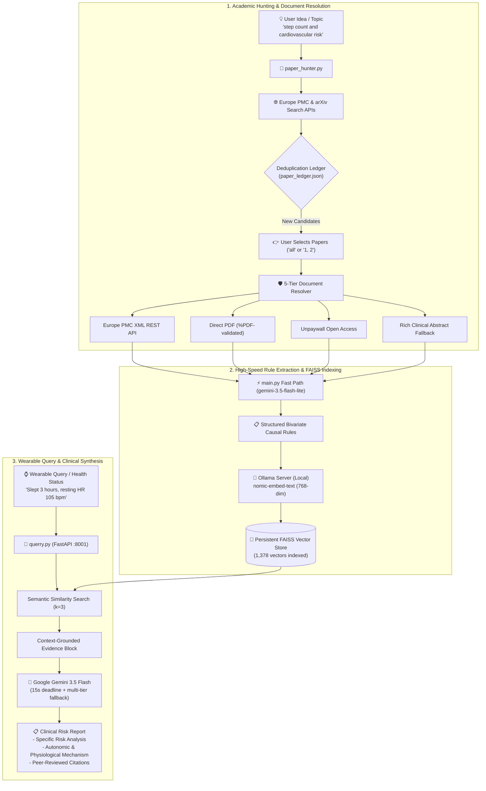
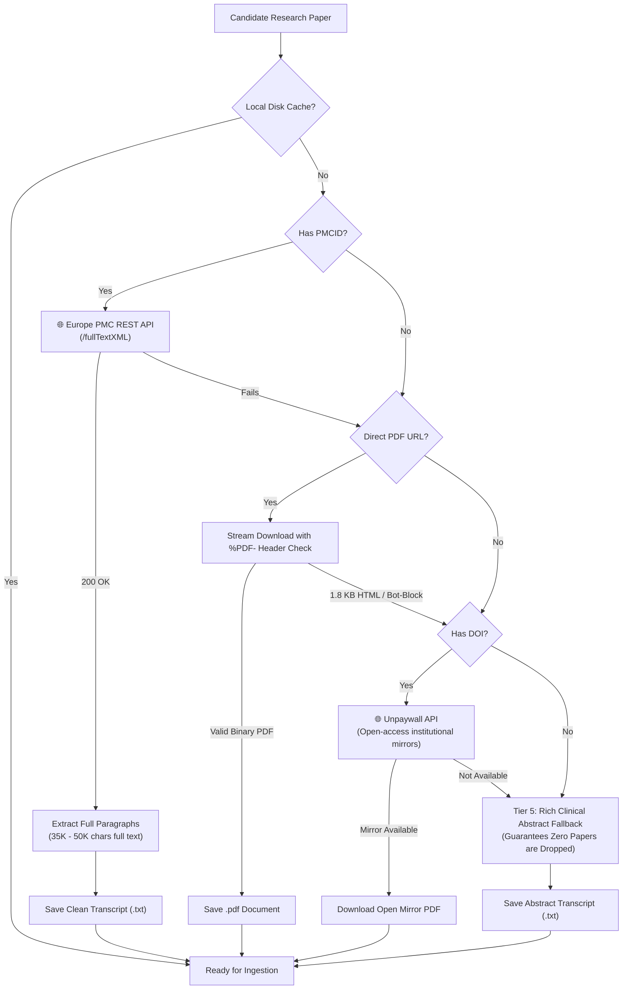

# 🧬 Biomedical Rules Extractor & Clinical Health RAG System

[](https://www.python.org/)
[](https://fastapi.tiangolo.com/)
[](https://ai.google.dev/)
[](https://www.langchain.com/)
[](https://github.com/facebookresearch/faiss)
[](https://ollama.ai/)
[](https://europepmc.org/)
[](https://arxiv.org/)
[](https://colab.research.google.com/drive/1lmXZjH49KE6-8EeNyUAFmHm2gQ8LzW6V?usp=sharing)

> **A peer-reviewed Clinical Intelligence & Retrieval-Augmented Generation (RAG) system that hunts academic literature, extracts causal biomedical rules in under 10 seconds via Google Gemini Flash-Lite, and synthesizes grounded physiological risk reports for wearable sensor queries with verified scientific citations.**

---

## 📌 Table of Contents
1. [Overview](#-overview)
2. [Key Capabilities & Features](#-key-capabilities--features)
3. [System Architecture](#-system-architecture)
4. [Zero-Skip Multi-Source Document Resolver](#-zero-skip-multi-source-document-resolver)
5. [Causal Rule Schema](#-causal-rule-schema)
6. [Interactive Paper Hunter CLI](#-interactive-paper-hunter-cli)
7. [Vector Storage & Ollama Embeddings](#-vector-storage--ollama-embeddings)
8. [Clinical Synthesis API (Gemini RAG)](#-clinical-synthesis-api-gemini-rag)
9. [Step-by-Step Setup Guide](#-step-by-step-setup-guide)
10. [Autonomous Colab Tunnel Orchestrator](#-autonomous-colab-tunnel-orchestrator)
11. [Project Structure](#-project-structure)
12. [Troubleshooting & Resilience Engineering](#-troubleshooting--resilience-engineering)

---

## 🔬 Overview

Modern consumer wearables (smartwatches, rings, fitness bands) monitor continuous physiological signals: **heart rate, heart rate variability (HRV), sleep staging, respiratory rate, and daily step volume**. However, translating these raw measurements into actionable preventive guidance requires firm grounding in peer-reviewed clinical research.

This project bridges that gap with an autonomous pipeline:
1. **Automated Academic Paper Hunter**: Enter any lifestyle or medical idea (e.g. *"step count and cardiovascular health"*, *"sleep deprivation arterial pressure"*), and the system retrieves candidate papers from **Europe PMC** and **arXiv**.
2. **Zero-Skip Document Resolver**: Bypasses publisher paywalls and bot-blocks using Europe PMC's official `fullTextXML` REST API, direct PDF validation, and Unpaywall open-access mirrors.
3. **High-Speed Causal Extraction**: Discovers structured conditional health rules in **~3–9 seconds** per paper using **`gemini-3.5-flash-lite`** with live terminal progress indicators.
4. **Persistent Vector Knowledge Base**: Embeds and indexes rules cumulatively into local **FAISS** (currently **1,378 embedded vectors** across 14 clinical studies).
5. **Wearable RAG Synthesis API**: Translates acute user sensor states into structured clinical risk reports with lead author citations and biological rationale.

---

## ⚡ Key Capabilities & Features

| Capability | Previous State | Current State | Impact |
| :--- | :--- | :--- | :--- |
| **Paper Search & Ingestion** | Manual PDF downloading & file placement | Automated interactive search CLI (`paper_hunter.py`) | **1-Click Topic Ingestion** |
| **Extraction Latency** | 120–160 seconds per paper (slow CPU Ollama) | **~3–9 seconds** via `gemini-3.5-flash-lite` | **~25x Acceleration** ⚡ |
| **Paywall & Bot-Block Resilience** | 1.8 KB HTML error crashes & skipped papers | 5-Tier Waterfall (Europe PMC XML, Unpaywall, Abstract fallback) | **Zero-Skip Guarantee** 🛡️ |
| **Terminal Observability** | Silent freeze during extraction | 4-Step live progress bar + real-time rule previews | **Complete Transparency** 📊 |
| **Colab Server Management** | Manual notebook running & URL copy-pasting | Autonomous execution & URL synchronization (`colab_automator.py`) | **Zero-Touch Execution** 🤖 |
| **Deduplication** | Potential duplicate vector re-ingestion | Persistent ledger (`paper_ledger.json`) with Jaccard title matching | **Zero Redundancy** 🎯 |

---

## 🏗️ System Architecture



---

## 🛡️ Zero-Skip Multi-Source Document Resolver

Publishers like Oxford Academic and BMJ often return an automated 1.8 KB HTML anti-bot redirect to script downloaders. The system handles this through a 5-tier waterfall resolution:



---

## 📋 Causal Rule Schema

Extracted relations conform to a rigorous 7-field biomedical relational format:

```json
{
  "metric_a": "sleep duration",
  "change_a": "decreases",
  "metric_b": "risk of major adverse cardiovascular events",
  "change_b": "increases",
  "predicted_outcome": "major adverse cardiovascular events",
  "confidence_rationale": "Prospective analysis of 71,455 UK Biobank participants demonstrated that device-measured short sleep duration combined with low step counts significantly amplified incident major adverse cardiovascular event (MACE) hazard ratios.",
  "author_name": "Joreintje D. Mackenbach et al.",
  "publication_date": "2024",
  "source_pdf": "joint-associations-of-device-measured-step-count-and-sleep-duration-with-inciden.txt"
}
```

* **`metric_a` & `change_a`**: Primary biomarker/behavioral state and vector direction (`increases`, `decreases`, `stays_stable`).
* **`metric_b` & `change_b`**: Secondary mediator or physiological variable.
* **`predicted_outcome`**: Downstream clinical hazard or physiological outcome.
* **`confidence_rationale`**: Verbatim scientific justification directly from the study text.
* **`author_name` & `publication_date`**: Academic attribution for clinical citations.

---

## 🔍 Interactive Paper Hunter CLI

To discover, select, and ingest new clinical literature, simply execute:

```powershell
python paper_hunter.py
```

### Live Terminal Workflow Preview:
```text
================================================================================
🧬 AUTOMATED RESEARCH PAPER HUNTER & CLINICAL EXTRACTION PIPELINE
================================================================================

💡 Enter your health / lifestyle research idea: step count and cardiovascular health
📊 How many research papers to fetch? (default: 5): 3

🔍 Searching for peer-reviewed papers matching: 'step count and cardiovascular health'...

================================================================================
📚 CANDIDATE RESEARCH PAPERS FOUND (3):
================================================================================

[1] [NEW] Joint associations of device-measured step count and sleep duration with incident major adverse cardiovascular events
    👤 Authors: Joreintje D. Mackenbach et al. (2024)
    📦 Source: Europe PMC | Status: Open-Access Article
    📝 Summary: Prospective cohort study assessing joint associations of accelerometer-measured step count and sleep metrics...
    🔗 PubMed Central: PMC12876295

--------------------------------------------------------------------------------
Available new papers for extraction: [1]
👉 Enter paper number(s) to extract (e.g. '1', '1,2', or 'all' / 'q' to quit): 1

================================================================================
🚀 [1/1] EXTRACTING: Joint associations of device-measured step count...
================================================================================
  [1/4] 🌐 Resolving open-access article via Europe PMC REST API (PMC12876295)...
  [1/4] ✅ Full research paper resolved (44.9 KB, PMC12876295)!
  [2/4] 📖 Reading & parsing research transcript (46,027 characters)... (20%)
  [3/4] 🧠 Querying high-speed model (gemini-3.5-flash-lite)... (60%)

  ✨ Discovered 2 causal relations:
     • step count (decreases) + risk of MACE (increases) ➔ major adverse cardiovascular events
     • sleep duration (decreases) + risk of MACE (increases) ➔ major adverse cardiovascular events

  [4/4] 💾 Cumulative FAISS indexing complete (Total vectors: 1378)
  📖 Recorded in paper_ledger.json (+2 rules)
  📝 Updated progress.md context successfully!
  🏁 [SUCCESS] Paper completed in 6.26s via direct-gemini-fast!
```

---

## 💾 Vector Storage & Ollama Embeddings

- **Local Embedding Engine**: [Ollama](https://ollama.ai/) running `nomic-embed-text` (768-dimensional embeddings) on `http://localhost:11434`.
- **Persistent Index**: FAISS index saved to [`local_persistent_vector_store/`](local_persistent_vector_store/) (`index.faiss` and `index.pkl`).
- **Cumulative Indexing**: Every ingestion appends new vectors cumulatively without overwriting existing literature.
- **Current Vector Count**: **1,378 embedded causal vectors** across 14 peer-reviewed clinical studies.

---

## 🧠 Clinical Synthesis API (Gemini RAG)

Start the FastAPI prediction server:
```powershell
python querry.py
```
The server runs on `http://127.0.0.1:8001`.

### Endpoint: `POST /predict-risk`

#### Example Request:
```bash
curl -X POST "http://127.0.0.1:8001/predict-risk" \
     -H "Content-Type: application/json" \
     -d '{"query_description": "I slept only 3 hours and my resting heart rate is 105 bpm"}'
```

#### Example Response:
```json
{
  "status": "success",
  "user_query": "I slept only 3 hours and my resting heart rate is 105 bpm",
  "gemini_report": "### 1. Risk Analysis\nSleeping for only 3 hours combined with elevated resting heart rate indicates acute sleep debt and sympathetic autonomic overdrive...\n\n### 2. Physiological Mechanism\nSleep deprivation impairs normal nocturnal blood pressure dipping and elevates daytime sympathetic vascular tone via hypothalamic-pituitary-adrenal (HPA) axis hyperactivation...\n\n### 3. Academic Citations\n- Alécio Vinícius Sá Gomes e Farias et al. (2022), The association between sleep deprivation and arterial pressure variations.\n- Joreintje D. Mackenbach et al. (2024), UK Biobank prospective cardiovascular analysis.",
  "raw_retrieved_rules": [
    {
      "content": "A decreases in sleep duration and increases in risk of major adverse cardiovascular events leads to major adverse cardiovascular events...",
      "metadata": {
        "metric_a": "sleep duration",
        "change_a": "decreases",
        "metric_b": "risk of major adverse cardiovascular events",
        "change_b": "increases",
        "predicted_outcome": "major adverse cardiovascular events",
        "author": "Joreintje D. Mackenbach et al.",
        "publication_date": "2024"
      },
      "similarity_distance": 0.381
    }
  ]
}
```

---

## 🚀 Step-by-Step Setup Guide

### 1. Prerequisites
- **Python 3.10+**
- **Ollama**: [Download & install Ollama](https://ollama.ai)
- **Google Gemini API Key**: [Free key from Google AI Studio](https://aistudio.google.com/)

### 2. Installation
```powershell
# Clone the repository
git clone https://github.com/oolalabravo/health-rules-extractor-rag.git
cd health-rules-extractor-rag

# Install dependencies
pip install -r requirements.txt
```

### 3. Pull Local Embedding Model
```powershell
ollama pull nomic-embed-text
```

### 4. Configure Environment
Copy `.env.example` to `.env` and insert your Gemini API Key:
```env
GEMINI_API_KEY=your_actual_gemini_api_key_here
```

### 5. Ingest Literature or Query
- **To hunt and extract new papers**:
  ```powershell
  python paper_hunter.py
  ```
- **To start the wearable clinical query server**:
  ```powershell
  python querry.py
  ```
- **To test a sample query**:
  ```powershell
  python test_request.py
  ```

---

## 🤖 Autonomous Colab Tunnel Orchestrator

For users running the extraction backend on Google Colab:
- **Notebook**: [`https://colab.research.google.com/drive/1lmXZjH49KE6-8EeNyUAFmHm2gQ8LzW6V`](https://colab.research.google.com/drive/1lmXZjH49KE6-8EeNyUAFmHm2gQ8LzW6V)
- **Automator Script**: [`colab_automator.py`](colab_automator.py)
  - Automatically executes Cell 0 via MCP browser connection or stdio.
  - Automatically discovers either Cloudflare zero-auth or Ngrok tunnel URLs.
  - Verifies `/health` responsiveness and writes the tunnel URL into `.env` under `COLAB_API_URL` without any manual copy-pasting!

---

## 📁 Project Structure

```text
health-rules-extractor-rag/
├── local_persistent_vector_store/     # Persistent FAISS vector database (1,378 vectors)
│   ├── index.faiss                     # High-dimensional binary vector index
│   └── index.pkl                       # Pickled LangChain metadata dictionary
├── paper_hunter.py                    # Interactive Paper Hunter CLI & Multi-Source Resolver
├── main.py                            # Fast Gemini Flash-Lite extractor & FAISS embedder
├── querry.py                          # FastAPI endpoint with Gemini RAG clinical synthesis
├── colab_automator.py                 # Autonomous Colab trigger & .env URL synchronizer
├── paper_ledger.json                  # Deduplication ledger tracking 14 clinical studies
├── progress.md                        # Context state log maintained per AGENT_RULES.md
├── test_request.py                    # Test client script with formatted output
├── requirements.txt                   # Production Python dependencies
├── .env.example                       # Environment template
├── .gitignore                         # Excludes .env, caches, and large binary PDFs
└── README.md                          # Full system documentation
```

---

## 🛡️ Troubleshooting & Resilience Engineering

| Symptom | Cause | Built-in Resolution |
| :--- | :--- | :--- |
| **`429 RESOURCE_EXHAUSTED` on Gemini** | Gemini 3.5 Flash free quota reached | The ingestion engine automatically switches to **`gemini-3.5-flash-lite`** (separate quota pool) with candidate fallbacks. |
| **Publisher 1.8 KB HTML error** | Publisher blocks automated PDF downloads | The multi-source resolver queries **Europe PMC `fullTextXML` REST API** or Unpaywall mirrors to get full research text. |
| **API hangs indefinitely** | Model delay or upstream gateway stall | `querry.py` enforces a **15-second strict timeout** and falls back through 3 candidate models to an offline deterministic synthesis. |
| **ConnectionRefused on :11434** | Ollama daemon not running | Ensure `ollama serve` is active or start the Ollama desktop app. |
| **Windows console Unicode crash** | Academic papers with thin spaces or Greek symbols | All scripts configure `sys.stdout` and `sys.stderr` with UTF-8 encoding and error replacement guards. |

---

## 📄 License
This project is open-source and available under the [MIT License](LICENSE).
