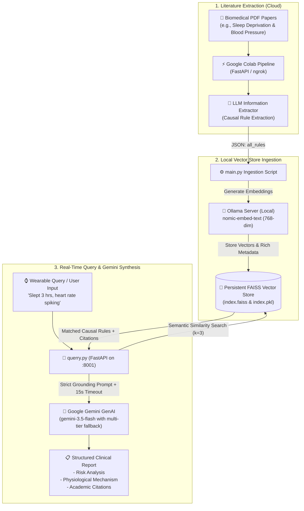

# 🧬 Biomedical Rules Extractor & Clinical Health RAG System

[](https://www.python.org/)
[](https://fastapi.tiangolo.com/)
[](https://ai.google.dev/)
[](https://www.langchain.com/)
[](https://github.com/facebookresearch/faiss)
[](https://ollama.ai/)
[](https://colab.research.google.com/drive/1lmXZjH49KE6-8EeNyUAFmHm2gQ8LzW6V?usp=sharing)

> **A peer-reviewed Clinical Intelligence & Retrieval-Augmented Generation (RAG) system that extracts causal biomedical relationships from academic literature and synthesizes actionable physiological risk reports for wearable sensor queries with verified scientific citations.**

---

## 📌 Table of Contents
1. [Overview](#-overview)
2. [System Architecture](#-system-architecture)
3. [How Biomedical Relations Are Fetched (Colab Pipeline)](#-how-biomedical-relations-are-fetched-colab-pipeline)
4. [How Relations Are Embedded & Indexed (Local FAISS)](#-how-relations-are-embedded--indexed-local-faiss)
5. [How Clinical Responses Are Made (Gemini Synthesis)](#-how-clinical-responses-are-made-gemini-synthesis)
6. [Step-by-Step Setup & How-To Guide](#-step-by-step-setup--how-to-guide)
7. [API Specification](#-api-specification)
8. [Project Structure](#-project-structure)
9. [Troubleshooting & Resilience Engineering](#-troubleshooting--resilience-engineering)

---

## 🔬 Overview

Modern wearable devices (smartwatches, rings, fitness trackers) monitor acute physiological metrics like **heart rate, HRV, sleep duration, and body temperature**. However, translating those raw data points into actionable clinical intelligence requires grounding in peer-reviewed scientific literature.

This project bridges that gap:
1. **Extracts causal clinical rules** from biomedical research papers (PDFs) via an AI-powered extraction pipeline running on [Google Colab](https://colab.research.google.com/drive/1lmXZjH49KE6-8EeNyUAFmHm2gQ8LzW6V?usp=sharing).
2. **Stores and indexes** these causal relationships locally in a high-dimensional vector database ([FAISS](https://github.com/facebookresearch/faiss)) using local [Ollama](https://ollama.ai/) embeddings (`nomic-embed-text`).
3. **Translates wearable state queries** (e.g., *"I slept for only 3 hours and my heart rate is spiking"*) into structured clinical risk reports synthesized by **Google Gemini**, with:
   - Specific physiological risk analysis.
   - Biological mechanism & autonomic nervous system rationale.
   - Academic lead author citations and source document attribution.

---

## 🏗️ System Architecture



---

## 🔍 How Biomedical Relations Are Fetched (Colab Pipeline)

The upstream rule extraction is hosted on Google Colab:
🔗 **[Google Colab Notebook: Biomedical Rule Extraction](https://colab.research.google.com/drive/1lmXZjH49KE6-8EeNyUAFmHm2gQ8LzW6V?usp=sharing)**

### 1. Document Ingestion
Academic papers (such as systematic literature reviews on sleep deprivation, autonomic tone, arterial hypertension, and cortisol rhythms) are sent via HTTP `POST` from `main.py` to the Colab server's `/extract-rules` endpoint (tunneled via `ngrok`).

### 2. Causal Rule Extraction Engine
The Colab backend parses the PDF documents into sections and prompts an LLM with biomedical extraction directives to identify **bivariate and multivariate causal links**. Rather than extracting raw unorganized text chunks, the pipeline extracts structured relational JSON schemas.

### 3. The Causal Rule Schema
Each extracted rule adheres to the following structured format:

```json
{
  "metric_a": "sleep deprivation",
  "change_a": "increases",
  "metric_b": "cortisol and lipids levels",
  "change_b": "increases",
  "predicted_outcome": "cardiovascular disease and overall mortality",
  "confidence_rationale": "Sleep deprivation (SD) plays an important role in blood pressure elevation via neuroendocrine alterations. This link is supported by increased cortisol and lipids after several days of sleep deprivation, indicating disturbance in the hypothalamic-pituitary-adrenal (HPA) axis.",
  "author_name": "Alécio Vinícius Sá Gomes e Farias et al.",
  "publication_date": "2022",
  "source_pdf": "The association between sleep deprivation and arterial pressure variations_ a systematic literature review.pdf"
}
```

#### Field Explanations:
* `metric_a`: Primary observed biomarker or behavioral condition (e.g., *sleep deprivation*, *REM rebound*, *arterial pressure*).
* `change_a`: Vector direction (`increases`, `decreases`, `stays_stable`).
* `metric_b`: Secondary physiological mediator or downstream biological marker (e.g., *cortisol levels*, *sympathetic vascular tone*, *wake after sleep onset*).
* `change_b`: Direction of secondary mediator change.
* `predicted_outcome`: Clinical hazard or long-term diagnosis (e.g., *acute hypertension*, *metabolic syndrome*, *arrhythmia*).
* `confidence_rationale`: Verbatim scientific rationale extracted from the peer-reviewed study describing the exact mechanism.
* `author_name` & `publication_date`: Formal academic attribution for medical citation.
* `source_pdf`: Origin document filename.

---

## 💾 How Relations Are Embedded & Indexed (Local FAISS)

Once received by [`main.py`](main.py):

### 1. Rich Semantic Representation
To enable both semantic discovery and factual provenance, each rule is synthesized into a rich embedding string:
```python
text_repr = (
    f"A {r['change_a']} in {r['metric_a']} and "
    f"{r['change_b']} in {r['metric_b']} leads to {r['predicted_outcome']}. "
    f"Rationale: {r['confidence_rationale']} "
    f"(Study by {r['author_name']} in {r['publication_date']}, Source: {r['source_pdf']})"
)
```

### 2. Local Ollama Embeddings
- **Model**: `nomic-embed-text`
- Runs 100% locally on `http://localhost:11434` without sending private health data or embeddings to third-party providers.
- Produces dense 768-dimensional vector representations.

### 3. FAISS Persistent Index
- Stored on disk in [`local_persistent_vector_store/`](local_persistent_vector_store/) (`index.faiss` and `index.pkl`).
- If an index already exists, `main.py` loads it and executes **cumulative merging** (`vector_store.add_texts`), preserving all previously indexed medical literature.
- Full dictionary metadata is preserved alongside each vector for fast UI citation rendering.

---

## 🧠 How Clinical Responses Are Made (Gemini Synthesis)

When a query arrives at [`querry.py`](querry.py):

### 1. Vector Search
A wearable status query like `"I slept for only 3 hours and my heart rate is spiking"` is converted into an embedding using Ollama and compared against FAISS via L2 distance similarity:
```python
results = vector_store.similarity_search_with_score(query_description, k=3)
```

### 2. Grounded Prompt Formulation
The top matching literature rules are formatted into an evidence context block. The LLM is instructed to act as a clinical intelligence system and **strictly constrain its deduction to the retrieved rules**:

```text
You are an advanced AI health intelligence system. 
Analyze the user's wearable state / query: "{query_description}"

Using strictly the following peer-reviewed literature rules retrieved from our local vector database:
{context_text}

Provide a detailed, structured response that includes:
1. Risk Analysis: Explicitly state the bad routine or health risk identified based on the literature.
2. Physiological Rationale: Explain the biological mechanism behind why this happens.
3. Academic Citations: Cite the lead authors, publication years, and source documents accurately.
```

### 3. Robust Gemini Multi-Model Orchestration
To avoid hanging and outages, the API utilizes a resilient multi-tier fallback architecture:
* **Primary Model**: `gemini-3.5-flash` (lightning fast, responsive, high-reasoning capacity).
* **Tier-2 Fallback**: `gemini-3-flash-preview`.
* **Tier-3 Fallback**: `gemini-3.8-flash`.
* **Network Deadline**: Explicit 15-second client timeout (`types.HttpOptions(timeout=15000)`). If a model encounters heavy demand or 503 errors, the system catches it within seconds and rolls over to the next candidate.
* **Deterministic Offline Fallback**: If internet connectivity is down or all remote models fail, the API automatically falls back to an offline deterministic clinical synthesis using the raw FAISS rules, guaranteeing that the endpoint **never hangs**.

---

## 🚀 Step-by-Step Setup & How-To Guide

### Prerequisites
- **Python**: 3.10, 3.11, 3.12, or 3.13
- **Ollama**: Installed and running locally ([Download Ollama](https://ollama.ai))
- **Google Gemini API Key**: Free key from [Google AI Studio](https://aistudio.google.com/)

---

### Step 1: Clone the Repository
```bash
git clone https://github.com/oolalabravo/health-rules-extractor-rag.git
cd health-rules-extractor-rag
```

### Step 2: Install Python Dependencies
```bash
pip install -r requirements.txt
```

### Step 3: Start Ollama & Pull Embedding Model
Make sure the Ollama desktop service is running, then pull the `nomic-embed-text` model:
```bash
ollama pull nomic-embed-text
```

Verify that Ollama is responding:
```bash
curl http://localhost:11434/api/tags
```

### Step 4: Configure Your API Key
Copy the template file to `.env`:
```bash
copy .env.example .env
```
*(On Linux/macOS: `cp .env.example .env`)*

Open `.env` in any text editor and paste your Google Gemini API Key:
```env
GEMINI_API_KEY=your_actual_gemini_api_key_here
```

---

### Step 5: (Optional) Ingest New Research Papers
The repository already includes a pre-indexed vector database in `local_persistent_vector_store/`. 

If you want to ingest additional PDFs:
1. Open the [Google Colab Notebook](https://colab.research.google.com/drive/1lmXZjH49KE6-8EeNyUAFmHm2gQ8LzW6V?usp=sharing).
2. Run the cells to launch the FastAPI rule extraction server and copy the generated `ngrok` URL.
3. Paste the URL into `COLAB_API_URL` inside [`main.py`](main.py).
4. Run the ingestion script:
   ```bash
   python main.py
   ```

---

### Step 6: Start the Local API Server
Start the FastAPI server:
```bash
python querry.py
```
The server will start listening at:
`http://127.0.0.1:8001`

---

### Step 7: Send a Wearable Health Query
In another terminal, test the service using the provided test client:
```bash
python test_request.py
```

Or test directly via `curl` / PowerShell:
```powershell
curl -X POST "http://127.0.0.1:8001/predict-risk" `
     -H "Content-Type: application/json" `
     -d '{"query_description": "I slept for only 3 hours and my heart rate is spiking"}'
```

---

## 📡 API Specification

### Endpoint: `POST /predict-risk`

#### Request Payload:
```json
{
  "query_description": "I slept for only 3 hours and my heart rate is spiking"
}
```

#### Response (`200 OK`):
```json
{
  "status": "success",
  "user_query": "I slept for only 3 hours and my heart rate is spiking",
  "gemini_report": "### 1. Risk Analysis\nBy sleeping for only 3 hours, you are experiencing acute Sleep Deprivation (SD)...",
  "raw_retrieved_rules": [
    {
      "content": "A increases in chronic blood pressure elevation and increases in cortisol and lipids levels leads to cardiovascular disease...",
      "metadata": {
        "metric_a": "chronic blood pressure elevation",
        "change_a": "increases",
        "metric_b": "cortisol and lipids levels",
        "change_b": "increases",
        "predicted_outcome": "cardiovascular disease and overall mortality",
        "author": "Alécio Vinícius Sá Gomes e Farias et al.",
        "publication_date": "2022",
        "source_pdf": "The association between sleep deprivation and arterial pressure variations_ a systematic literature review.pdf"
      },
      "similarity_distance": 0.412
    }
  ]
}
```

---

## 📁 Project Structure

```text
health-rules-extractor-rag/
├── local_persistent_vector_store/     # Pre-built FAISS vector store
│   ├── index.faiss                     # Binary FAISS vector index
│   └── index.pkl                       # Pickled LangChain metadata index
├── RESEARCH PAPERS/                   # Source biomedical papers (PDFs)
│   └── The association between sleep deprivation and arterial pressure variations...pdf
├── main.py                            # PDF uploader, Colab sync & FAISS embedder
├── querry.py                          # FastAPI endpoint with Gemini RAG synthesis
├── test_request.py                    # Test client script with formatted output
├── requirements.txt                   # Production Python dependencies
├── .env.example                       # Environment configuration template
├── .gitignore                         # Git exclusions (.env, caches)
└── README.md                          # Comprehensive documentation
```

---

## 🛡️ Troubleshooting & Resilience Engineering

| Symptom | Cause | Solution |
| :--- | :--- | :--- |
| **API hangs indefinitely** | Model overload / missing SDK timeout on `gemini-3.8-flash` | The system now enforces a 15-second deadline and automatically falls back to `gemini-3.5-flash`. |
| **`GEMINI_API_KEY is not set`** | Missing `.env` file | Copy `.env.example` to `.env` and insert your Gemini API Key from Google AI Studio. |
| **`ConnectionRefusedError: 11434`** | Local Ollama service is not running | Launch Ollama from your applications menu or run `ollama serve`. |
| **`Vector store not found`** | Script executed from foreign directory | Both `querry.py` and `main.py` resolve the database path relative to `__file__`, keeping paths consistent across environments. |
| **Unicode encoding crash on Windows** | Academic PDFs containing UTF-8 ligatures (`\ufb01`) printed to `cp1252` console | `querry.py` automatically configures `sys.stdout` to UTF-8 with error replacement. |

---

## 📄 License
This project is open-source and available under the [MIT License](LICENSE).
